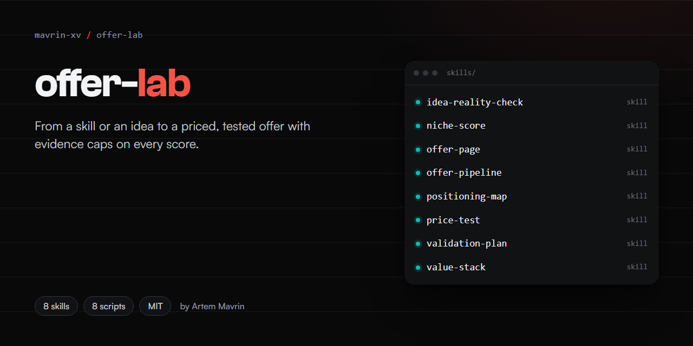
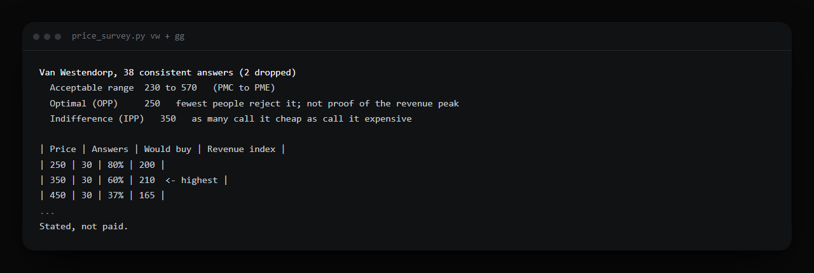

# offer-lab

**Turns a skill or an idea into a priced, tested offer with your AI agent: pick the niche that pays, check the idea against real evidence, find the claim no rival owns, build the stack and guarantee, set the price, lint the page and judge the test with numbers you wrote down first.**

Most first offers fail before the copy. The buyer was too broad, the pain was real but nobody paid to fix it, the price was a guess, and a week of signups looked like a market.

[](LICENSE)




```bash
git clone https://github.com/mavrin-xv/offer-lab && cd offer-lab
./install.sh                 # or: ./install.sh --project
```

<!-- install-notes:start -->
Other ways in: as a Claude Code plugin, run `/plugin marketplace add mavrin-xv/offer-lab` and then `/plugin install offer-lab@offer-lab`. For Codex or another agent that reads `SKILL.md`, copy the folders under `skills/` into its skills directory. On Windows, run `install.sh` from Git Bash or WSL and type `py -3` where these docs say `python3`.
<!-- install-notes:end -->

Then tell your agent: `score these niches: ...` or `reality check this idea: ...` or `what should I charge for this?`

---

## What it solves

| Pain | What the pack does |
|---|---|
| "Who should I sell to?" | `niche_score.py` scores Money, Channel and Pain with caps: no exact channel query, no quote in the buyer's words, no named spend, and the score drops. With 10+ won and lost deals, `icp_traits.py` finds the traits that separate them and tests the profile on deals it has not seen |
| Friends said it was a great idea | `reality_check.py` weights paid items 5, commitments 3, compliments 0, and says GO, TEST, WAIT or KILL. TEST is the default |
| Every rival says the same thing | `claim_triage.py` counts which claims are saturated, contested or white space, and which complaints buyers make about every rival, doing nothing included |
| The offer feels weak, so you add bonuses | `value_equation.py` scores the four levers of the value equation, names the weakest, and blocks any objection no item answers, a guarantee with no number or window, and scarcity with no reason |
| The price is a guess | `price_survey.py` reads Van Westendorp and Gabor-Granger surveys and prints the range and the revenue peak, labelled as stated, not paid |
| The page is full of "we" and fake urgency | `offer_page_lint.py` blocks placeholders, unexplained scarcity, a missing price and a vague guarantee, and warns on hype words, a long hero and several calls to action |
| 40 signups, so build it? | `validation_calc.py` sizes the test before it starts and judges it with a 95% interval: GO, KILL, KEEP RUNNING or UNCLEAR |

## What's inside

| Skill | What it does | What to say |
|---|---|---|
| `offer-pipeline` | One offer card, seven gates, routes each request to the right stage | "help me make an offer", "turn my skill into a product" |
| `niche-score` | Money, Channel, Pain with evidence caps; channel map, service angle, kill criteria; buyer profile from deals | "which niche should I pick", "who is my ideal customer" |
| `idea-reality-check` | Evidence ladder, top 3 failure modes with tests, competition including doing nothing | "is this idea any good", "reality check this" |
| `positioning-map` | Dunford's components, claim triage across rivals, 8 angle generators and a 7-point gate | "how do I stand out", "find an angle" |
| `value-stack` | Value equation, stack mapped to objections, named guarantee, mechanism, honest scarcity | "make the offer", "write a guarantee" |
| `price-test` | Value metric, anchor, tiers, price surveys, symptoms, price-change rules | "what should I charge", "should I raise prices" |
| `offer-page` | A one-page outline from the card and a linter for the draft | "write the sales page", "check my page" |
| `validation-plan` | Interviews, smoke tests, fake doors, pre-orders; lines written before the test, judged after | "how do I validate this", "did the test work" |

## Quick start

Every script runs offline on the bundled example: Northwind Ops, an invented two-person studio selling a monthly stock-count cleanup to online shops.

```bash
python3 skills/niche-score/scripts/niche_score.py examples/data/niches.csv
```

```
| # | Niche | M | C | P | Total | Verdict |
|---|---|---|---|---|---|---|
| 1 | Stock count cleanup for online shops with 200+ SKUs | 4 | 4 | 5 | 13/15 | SHIP |
| 2 | Returns and refund tracking for apparel shops | 4 | 4 | 4 | 12/15 | SHIP |
| 3 | Bookkeeping catch-up for dental clinics | 4 | 2 | 3 | 9/15 | ITERATE |
| 4 | Chatbot for local restaurants | 3 | 4 | 2 | 9/15 | ITERATE |
| 5 | Notion workspace setup for solo creators | 2 | 3 | 3 | 8/15 | ITERATE |

Caps applied:
- Bookkeeping catch-up for dental clinics: pain 4->3: no quote in their words
```

```bash
python3 skills/validation-plan/scripts/validation_calc.py judge --visitors 640 --conversions 29 --go 0.05 --kill 0.02
```

```
29 of 640 converted: 4.5% (95% range 3.2% to 6.4%)
Lines: GO 5.0%, KILL 2.0%. Plan: 191 visitors.
VERDICT: UNCLEAR  (enough visitors, still between the lines; apply your pre-written rule (default: KILL))
```

The full run, from niche to the test verdict, with real output at each step: [examples/walkthrough.md](examples/walkthrough.md).

## How it works

```
                         offer card (one per offer)
                                   |
 [1] niche  ->  [2] reality  ->  [3] positioning  ->  [4] value stack  ->  [5] price  ->  [6] page  ->  [7] test
  SHIP?          GO / TEST?       white space?         0 blockers?          one point?     lint 0?        GO?
     ^               ^                                                                                     |
     +---------------+---------------- interviews and test results feed the evidence ---------------------+
```

Each skill reads the offer card, does its stage, writes the result back and checks its gate. A failed gate names the
line that failed and the evidence that would pass it. More in [docs/how-it-works.md](docs/how-it-works.md).

## Configure

| Setting | Where | Default |
|---|---|---|
| Niche thresholds | `SHIP_AT`, `ITERATE_AT` near the top of `niche_score.py` | SHIP 11+, ITERATE 8 to 10, KILL under 8 |
| Holdout size | `icp_traits.py --holdout` | the newest 5 won and 5 lost |
| GO and KILL lines | `validation_calc.py --go --kill` | none: you set them from what the offer must earn |
| Survey yes threshold | `price_survey.py gg --top-box` | 1: only a 5 of 5 counts as yes |
| Output format | `--format json` on every script | markdown |

Install without the script: copy the folders in `skills/` to `~/.claude/skills/` (or your agent's skills folder).

## Honest limits

- The scores are your judgement. The scripts check that the judgement has evidence behind it; they do not know your market.
- Survey results are stated willingness to pay. People say yes more often in a survey than at a checkout.
- The niche thresholds, evidence weights and the 20% stack-cost line are this pack's defaults, not published standards.
- Van Westendorp has several intersection conventions; the script uses the one Wikipedia describes, so numbers can differ from other tools.
- The value equation index only compares versions of your own offer. It is not a market number.
- The frameworks were read through public summaries and notes, not reproduced from the books. Read the books for the full argument.
- The example shop studio, its rivals, deals, surveys and every number in them are invented.
- Not tested on real surveys or real deal data, and the skills were not run end to end by a live agent session.
- Tested on Windows with Git Bash and Python 3.12. macOS and Linux reports are welcome.

## Credits

- Based on / inspired by April Dunford, *Obviously Awesome* (2019), via Commoncog's summary https://commoncog.com/obviously-awesome/ and Yevgeniy Brikman's notes https://www.ybrikman.com/blog/2020/01/12/obviously-awesome/ (book; summaries used for structure only)
- Based on / inspired by Alex Hormozi, *$100M Offers* (2021): the value equation, the stack and guarantee types, via https://www.shortform.com/blog/alex-hormozi-guarantees/ and https://www.shortform.com/blog/starving-crowd/ (book; summaries used)
- Based on / inspired by Rob Fitzpatrick, *The Mom Test* (2013), via https://www.ybrikman.com/blog/2023/03/29/the-mom-test/ (book)
- Based on / inspired by the switch interview and the four forces: https://jobstobedone.org/switch-interview/ (article)
- Based on / inspired by Van Westendorp's Price Sensitivity Meter: https://en.wikipedia.org/wiki/Van_Westendorp%27s_Price_Sensitivity_Meter (CC BY-SA 4.0)
- Based on / inspired by the Gabor-Granger method: https://umbrex.com/resources/frameworks/pricing-frameworks/gabor-granger-method/ (article)
- Based on / inspired by Madhavan Ramanujam and Georg Tacke, *Monetizing Innovation* (2016), and the wondelai skill https://github.com/wondelai/skills (MIT)
- Based on / inspired by the pricing and offers skills in https://github.com/coreyhaines31/marketingskills (MIT)
- Based on / inspired by the positioning-angles skill in https://github.com/boringmarketer/boring-marketing-skills (MIT)
- Based on / inspired by value-based pricing guides https://www.robinwaite.com/blog/value-based-pricing and smoke-test guides https://www.koji.so/docs/smoke-test-product-validation and https://cleverx.com/blog/pre-launch-demand-testing-with-real-buyers (articles; their benchmark rates are quoted as vendor figures)
- Awareness stages from Eugene Schwartz, *Breakthrough Advertising* (1966) (book)

## Contributing

See [CONTRIBUTING.md](CONTRIBUTING.md). Notes for coding agents are in [AGENTS.md](AGENTS.md).

<!-- author:start -->
## Author

Built and maintained by [Artem Mavrin](https://github.com/mavrin-xv). This repo is one of a set of agent skill packs for marketing and operations work. Each one installs on its own; the full list is in [agent-skill-packs](https://github.com/mavrin-xv/agent-skill-packs). If a pack saved you an afternoon, a star helps other people find it.
<!-- author:end -->

## License

MIT. See [LICENSE](LICENSE).
